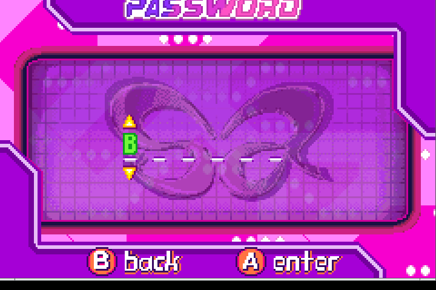
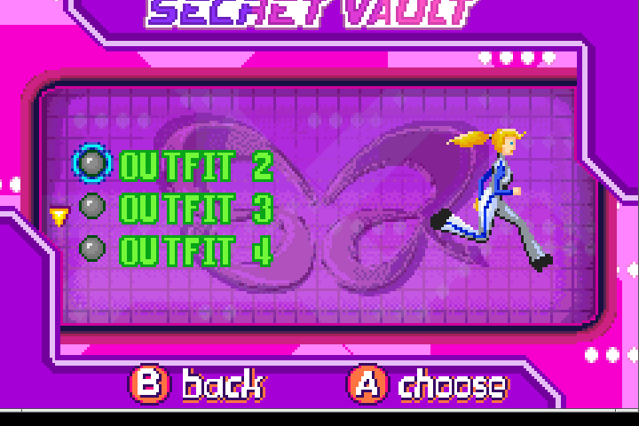

# Barbie Superpack: Secret Agent & Groovy Games (GBA) — Reverse Engineering Report

## 1. Target identity

| Field | Value |
|---|---|
| File | `Barbie Superpack - Secret Agent & Groovy Games.gba` |
| Size | 8,388,608 bytes (0x800000, 8 MiB) |
| Header @0x0 title / code / maker | `SUPERPAKVOL4` / `BBEE` / `7D`, version 0 |
| Header @0x400000 title / code / maker | `SECRETAGENTB` / `AAHE` / `7D`, version 0 |
| Fixed byte / complement | 0x96 / 0x38 (image 0), 0x96 / 0x50 (image 1), at 0xB2 / 0xBD |
| MD5 | `50552a80c5d80210c941e4ad8230e814` |
| SHA-1 | `75392f0cf1c3d79c04c5a0d9503cf979a5da2e7b` |
| SHA-256 | `af42452b27c0ea2234367bcddec927f6f2381eb879742a512dbf1ff3a0249083` |

Embedded GBA-header scan (156-byte Nintendo logo, hit at header+4): exactly **two**
images, both 4 MiB:

* **Image 0, base `0x08000000`, file 0x000000–0x3FFFFF — Groovy Games.** Title
  was patched to `SUPERPAKVOL4`; standalone Groovy Games is `GROOVY GAMES`/`AVBE`
  (MD5 `c1b8fbfc0f67a1f8e0c60543167b7dba`). The pack changed the header, the
  entry word (`0xEA0FD13E` → ARM branch to `0x083F4500`) and appended a boot
  selector at `0x083F4500` (that area is 0xFF filler in the standalone ROM).
* **Image 1, base `0x08400000`, file 0x400000–0x7FFFFF — Secret Agent Barbie:
  Royal Jewels Mission.** Title/code `SECRETAGENTB`/`AAHE`; entry
  `0xEA00002E` → `0x084000C0`. This is the standalone Secret Agent ROM
  (MD5 `b5da52577265dbb1d98977da249c4e20`) **relocated +0x400000**: 2,283 bytes
  differ, almost all pointer bytes (e.g. the alphabet pointer literal at
  `0x08400DD0` is `0x0860744C` here vs `0x0820744C` standalone). The password
  code itself is identical.

**Patch summary:** image 0 header + boot selector (`0x083F4500–0x083F4Cxx`);
image 1 is a relocated copy of the retail Secret Agent image. The selector writes
selection byte `0x0300085C` and jumps to `0x080000C0` (Groovy) or `0x084000C0`
(Secret Agent) at `0x083F49D4`. Observed: Left/Right toggles the two game logos,
A boots the selected half; default is Groovy Games.

## 2. Executive summary

The pack contains two independent 4 MiB games. **Groovy Games has no code
system**: no password/passcode/cheat/debug/unlock strings anywhere in image 0,
no alphabet, no button-code table found, and a fully enumerated menu tree whose
only secret is the Select-at-title credits. Its nine mini-games and all menus are
listed in §6b.2.

**Secret Agent** has a six-symbol password system, and the 13 codes published
for *Secret Agent Barbie: Royal Jewels Mission* belong to it. They are **not
stored as literals** in either the pack's Secret Agent half or the standalone
ROM (0 hits for every one of the 13). They are generated by a 24-bit checksum
codec at the start of the Secret Agent image:

* alphabet `BCDFGHJKLMNPQRST` (16 symbols, 4 bits each), `0x0860743C`;
* six symbols = five 4-bit payload nibbles + one 4-bit checksum;
* checksum `c5 = (c0+c1+c2+c3+c4+3) & 15`;
* `c0` is the current mission (0–11 used; 12–15 accepted but clamp the map
  cursor), and the other 16 payload bits are progress/unlock flags copied to
  `0x030004CA–0x030004D9`.

All 12 mission passwords published for the game decode under the same checksum,
but **`CBBDCX` is a published typo**: `X` is not in the alphabet and cannot be
typed. The correct code is **`CBBDCK`** (London Subway), confirmed in game.
`BBBBCG` (Royal Tower) and `GBBPFH` (Secret Hideout) were also accepted in game.

Two unpublished codes were minted and accepted: **`BTTTTT`** (Royal Tower +
every progress bit) and **`BBBBBF`** (Royal Tower + no progress bits). They
produce demonstrably different SECRET VAULT contents (outfits listed vs. three
empty rows), which proves the 16 flag bits are live and that the code space is
fully controllable, not just a table of 13 presets. Bounds were proven by
in-game rejection of a bad checksum and of the ROM's dead `HRRDMD` literal.



## 3. How to reproduce

### 3.1 Emulator

```bash
Xvfb :171 -screen 0 1024x768x24 &
DISPLAY=:171 openbox &
DISPLAY=:171 SDL_AUDIODRIVER=dummy mgba -3 \
  "roms/Barbie Superpack - Secret Agent & Groovy Games/Barbie Superpack - Secret Agent & Groovy Games.gba" &
W=$(DISPLAY=:171 xdotool search --name mGBA | head -1); xdotool windowfocus $W
```

mGBA 0.10.5, default SDL keymap: A=`x`, B=`z`, L=`a`, R=`s`, Start=`Return`,
Select=`BackSpace`, D-pad = arrows. Hold 300–450 ms per press; the game samples
input per frame and short taps are lost.

### 3.2 Getting into either half

1. Boot. Splash sequence: Vivendi → Lucky Chicken / One Man Band → DC Studios →
   **pack selector** ("Barbie Groovy Games" logo, left/right arrows, A button).
2. Selector: `Right` toggles to "SECRET AGENT Barbie", `A` boots it (white fade,
   DC Studios, then the Secret Agent title). `A` on Groovy boots Groovy Games.
3. Secret Agent: title `Press Start` → main menu **NEW GAME / CONTINUE** →
   `Down`, `A` on CONTINUE → **PASSWORD** entry.

### 3.3 Password entry rules (observed + derived)

* Six slots; the large green glyph is the current symbol.
* `Up` or `Right` increments the current symbol (`& 15`); `Down` or `Left`
  decrements (`& 15`). The symbol is only drawn on some frames (blink), so a
  screenshot may catch a blank slot — press once and re-shoot.
* `A` stores the symbol and advances; the symbol resets to `B`.
* After the sixth symbol one more `A` submits. The submit routine stores the
  symbol at `struct+0x32` (outside the six slots) and then runs the checksum.
* Rejection = error sound and the screen resets to empty (observed for
  `QBBBBB` and `HRRDMD`).

### 3.4 Exact paths used

* Groovy: `A` at selector → title → `Start` → How Many Players → `A` (1 player)
  → I Want to Be (Barbie) → `A` → I'll Play Against → `A` → Where Shall We Play?
  → arrows → `A` → Choose Difficulty → `A` → Ready to Play? → Start Game →
  in-game `Start` = pause.
* Secret Agent: `A` at selector → title → `Start` → `Down` `A` (CONTINUE) →
  password. After a valid code the game returns to HEADQUARTERS, whose ring is
  `SOUND → MISSIONS → STORY → SECRET VAULT → TRAINING → SOUND`.

### 3.5 Codes entered in-game

| Code | Result |
|---|---|
| `TTTTTS` | accepted; HEADQUARTERS with all content, SECRET VAULT opens |
| `BBBBCG` | accepted; HEADQUARTERS (Royal Tower state) |
| `CBBDCK` | accepted; map = ENGLAND, list = TOWER ROOF / THE ROYAL TOWER / **LONDON SUBWAY** |
| `BTTTTT` (novel) | accepted; map = ENGLAND; SECRET VAULT lists OUTFIT 2/3/4 |
| `BBBBBF` (novel) | accepted; map = ENGLAND; SECRET VAULT shows three empty rows |
| `QBBBBT` (mission 12) | accepted; header shows `PASSWORD: QBBBBT`, map cursor = MEXICO |
| `GBBPFH` | accepted; map = CHINA, list current = **SECRET HIDEOUT** |
| `QBBBBB` | **rejected** (checksum) |
| `HRRDMD` | **rejected** (checksum; see §5.4) |
| `CBBDCX` | not typeable (`X` is not a symbol) |

## 4. Address map

All ROM addresses are `0x08000000 + file offset`; image 1 runs at `0x08400000`.

| Address (ROM) | File | Meaning |
|---|---|---|
| `0x083F4500` | `0x3F4500` | boot selector, ARM reset stub (SP/IRQ setup), patched entry |
| `0x083F479C` | `0x3F479C` | selector menu (Thumb): fills key-jump table, draws logos |
| `0x083F49BC` | `0x3F49BC` | toggles selection byte `0x0300085C` |
| `0x083F49D4` | `0x3F49D4` | `ldrb 0x0300085C`; 0 → `0x080000C0`, else `0x084000C0`; `svc 1`; `bx` |
| `0x0860743C` | `0x60743C` | alphabet `BCDFGHJKLMNPQRST` (16 bytes, no terminator) |
| `0x0860744C` | `0x60744C` | `"HRRDMD"` hard-coded comparison string |
| `0x08400D1C` | `0x400D1C` | reset password state struct |
| `0x08400D68` | `0x400D68` | **checksum validator**, returns 1/0 |
| `0x08400DA8` | `0x400DA8` | compare six entered symbols to `"HRRDMD"` (dead path, §5.4) |
| `0x08400DD8` | `0x400DD8` | decode nibbles → game state (mission + 16 flags) |
| `0x08400EE8` | `0x400EE8` | encode game state → six nibbles (+checksum) |
| `0x08400FF4` | `0x400FF4` | nibbles → display string (alphabet lookup) |
| `0x08404448` | `0x404448` | password-screen update: key handling, slot draw, submit |
| `0x08404520` | `0x404520` | A-store: write symbol, advance index, call checksum at index>5 |
| `0x08404548` | `0x404548` | checksum gate; on success apply flags and return 5 |
| `0x084048E4` | `0x4048E4` | draw loop: `alphabet[struct[i]]` into each slot |
| `0x084067A0`, `0x08407232` | | two gameplay callers of the `HRRDMD` comparator |
| `0x08405F38` | `0x405F38` | UI descriptor referencing `"PASSWORD:"` (`0x086074A0`) |
| `0x08608C30` | `0x608C30` | `"YOUR PASSWORD IS"` (mission-end code display) |

RAM (IWRAM) password state, base **`0x030004B8`** (literal at `0x0840492C`):

| Offset | Meaning |
|---|---|
| `+0x08` | mission index (c0), byte |
| `+0x0C` | current entry symbol (0–15) |
| `+0x12–0x15` | 4 progress bits decoded from c4 (bit0→+0x12 … bit3→+0x15) |
| `+0x16–0x19` | 4 progress bits decoded from c2 |
| `+0x1A–0x1D` | 4 progress bits decoded from c3 |
| `+0x1E–0x21` | 4 progress bits decoded from c1 |
| `+0x28` | entry index (0–6), dword |
| `+0x2C–0x31` | six password nibbles c0..c5 |

## 5. Algorithm

### 5.1 Validator (reimplementation)

```python
A = "BCDFGHJKLMNPQRST"          # 0x0860743C, 16 symbols

def valid(code):
    if any(c not in A for c in code):   # UI cannot produce these
        return False
    v = [A.index(c) for c in code]
    return ((v[0] + v[1] + v[2] + v[3] + v[4] + 3) & 15) == v[5]
```

Assembly (`0x08400D68`): sum `struct[0x2C..0x30]`, `adds #3`, `ands #15`,
`cmp` with `struct[0x31]`; returns 1 on equality, 0 otherwise. The submit at
`0x08404548` tests the low byte and only then calls the decoder/apply path.

### 5.2 Payload layout

```text
code = c0 c1 c2 c3 c4 c5        (each a 4-bit symbol)
c0            mission index (0..11 used; 12..15 accepted)
c4 bits 0..3  progress flags 0x12..0x15
c2 bits 0..3  progress flags 0x16..0x19
c3 bits 0..3  progress flags 0x1A..0x1D
c1 bits 0..3  progress flags 0x1E..0x21
c5            checksum = (c0+c1+c2+c3+c4+3) & 15
```

Encoder `0x08400EE8` reads `[state+8]` and the 16 bytes `state+0x12..0x21`,
packs them into `state+0x2C..0x31` and computes `+0x31`. Decoder `0x08400DD8`
performs the inverse when a code is submitted. `0x08400FF4` turns the six
nibbles into the display string with the same alphabet (used by the
mission-end `"YOUR PASSWORD IS"` screen).

### 5.3 Space

* Six positions × 16 symbols = **16,777,216** possible strings.
* Exactly **1,048,576** are valid: the 20-bit payload `(c0..c4)` is free, and
  each payload has exactly one checksum symbol. Valid fraction = 1/16.
* No reserved symbols, no reserved payload value: every payload is
  representable. Out-of-alphabet characters are impossible from the UI because
  the entry routine masks the symbol with `& 15` and the alphabet has 16 bytes.

### 5.4 The dead `HRRDMD` literal

`0x08400DA8` maps `struct[0x2C..0x31]` through the alphabet and compares the
result with the literal `"HRRDMD"` at `0x0860744C`. It is called from two
gameplay scripts (`0x084067A0`, `0x08407232`) after a timer test. `HRRDMD` is
**not checksum-valid** (`5+13+13+2+9+3 & 15 = 13 = R`, not the final `D`), and
the only reachable way to fill the struct is the password screen, whose checksum
gate runs first. Entering `HRRDMD` in game was rejected (screenshot 20). It is
therefore a leftover/development string that cannot be reached through the
password UI.

### 5.5 Effect application

On a valid code the game resets the entry struct, calls `0x08400DD8` (decodes
mission + flags), and rebuilds the save/profile flag block at
`0x030004CA–0x030004D9`; it then returns 5 to the screen state machine, which
enters HEADQUARTERS. The decoded mission byte (`+0x08`) and flag block drive the
HEADQUARTERS ring, the SECRET VAULT list, and the mission map cursor. The map
header prints `PASSWORD: <last accepted code>` (observed for `CBBDCK`,
`GBBPFH`, `QBBBBT`).



## 6. Tables

### 6.1 Alphabet

`BCDFGHJKLMNPQRST` — 16 symbols, index = value 0..15, at `0x0860743C`.
Vowels and `X` are deliberately absent; a published code containing `X` cannot
be entered.

### 6.2 Published codes decoded

`c4/c2/c3/c1` are hexadecimal nibbles in the order used by the struct
(`c4`→0x12–0x15, `c2`→0x16–0x19, `c3`→0x1A–0x1D, `c1`→0x1E–0x21).

| Code | Mission | c1 | c2 | c3 | c4 | Published effect | Evidence |
|---|---:|---:|---:|---:|---:|---|---|
| `BBBBCG` | 0 | 0 | 0 | 0 | 1 | The Royal Tower (England) | Observed (HQ) |
| `CBBDCK` | 1 | 0 | 0 | 2 | 1 | London Subway (England) | Observed (map+list); published as `CBBDCX` |
| `DBBFCM` | 2 | 0 | 0 | 3 | 1 | Street Chase (England) | Derived (label from published list) |
| `FBBFFQ` | 3 | 0 | 0 | 3 | 3 | City Streets (China) | Derived |
| `GBBPFH` | 4 | 0 | 0 | b | 3 | Secret Hideout (China) | Observed (map+list) |
| `HBBPKN` | 5 | 0 | 0 | b | 7 | Golden City (China) | Derived |
| `JCBPKQ` | 6 | 1 | 0 | b | 7 | The Palace (China) | Derived |
| `KCBTKC` | 7 | 1 | 0 | f | 7 | Opera House (Italy) | Derived |
| `LCGTKJ` | 8 | 1 | 4 | f | 7 | Canal Chase (Italy) | Derived |
| `MCHTKL` | 9 | 1 | 5 | f | 7 | Fashion District (Italy) | Derived |
| `NCHTTC` | 10 | 1 | 5 | f | f | Scuba Search (Italy) | Derived |
| `PCRTTN` | 11 | 1 | d | f | f | Sunny City (Mexico) | Derived |
| `TTTTTS` | 15 | f | f | f | f | All Secrets Unlocked | Observed |

The flags are **cumulative progress**, not independent cheats: each published
mission code carries the bits accumulated up to that mission. That is why the
mission codes are not 13 arbitrary strings but a monotone sequence.

### 6.3 Mission index (c0) map

| c0 | Mission | Evidence |
|---:|---|---|
| 0 | The Royal Tower (England) | Observed |
| 1 | London Subway (England) | Observed |
| 2 | Street Chase (England) | Derived (published label) |
| 3 | City Streets (China) | Derived |
| 4 | Secret Hideout (China) | Observed |
| 5 | Golden City (China) | Derived |
| 6 | The Palace (China) | Derived |
| 7 | Opera House (Italy) | Derived |
| 8 | Canal Chase (Italy) | Derived |
| 9 | Fashion District (Italy) | Derived |
| 10 | Scuba Search (Italy) | Derived |
| 11 | Sunny City (Mexico) | Derived |
| 12–15 | no mission; map cursor clamps to Mexico | Observed for 12 |

## 6b. Enumeration

### 6b.1 Secret Agent

**Space definition.** Alphabet 16 symbols, length 6, four bits per symbol.
Payload = `c0..c4` = **20 bits = 1,048,576 states**; checksum = 4 bits; total
strings 16^6 = 16,777,216, of which exactly 1,048,576 pass. No reserved bits and
no reserved symbol; the only rejection rule is the checksum. Mission values
12–15 are representable and pass the checksum but have no mission entry.

**Novel codes (in no published list) and in-game proof.**

| Code | Payload | In-game result | Screenshot |
|---|---|---|---|
| `BTTTTT` | mission 0, all 16 progress bits | accepted → HEADQUARTERS (England); SECRET VAULT lists OUTFIT 2, OUTFIT 3, OUTFIT 4 | 16, 17 |
| `BBBBBF` | mission 0, zero progress bits | accepted → HEADQUARTERS; SECRET VAULT opens with three **empty** rows (dashes) | 18 |
| `QBBBBT` | mission 12, no flags | accepted; map header `PASSWORD: QBBBBT`, cursor MEXICO | 26 |
| `CTTTTB` … `PTTTTN` | mission 1..11 + all bits | generated by the encoder (family listed below); same class as `BTTTTT` | — |

`BTTTTT` vs `BBBBBF` is the controlled experiment: same mission, same entry
path, only the 16 flag bits differ, and the SECRET VAULT content changes from
three blank rows to named outfit unlocks. `BTTTTT` also differs from the only
published all-secrets code (`TTTTTS`), which sets mission 15.

**Bounds proven by rejection.**

* `QBBBBB` — bad checksum (`12+0+0+0+0+3 & 15 = 15`, stored `B=0`) → error
  sound, screen reset (screenshot 19).
* `HRRDMD` — matching the ROM's dead literal but failing the checksum
  (`5+13+13+2+9+3 & 15 = 13 = R`, stored `D=2`) → rejected, screen reset
  (screenshot 20). This also proves the `0x08400DA8` comparator is not part of
  the submit path.
* `CBBDCX` — contains `X`, which is not one of the 16 symbols and cannot be
  produced by the entry routine (`& 15`), so the published string is
  unrepresentable. `CBBDCK` (same first five symbols, correct checksum) is
  accepted and selects London Subway (screenshots 14, 15).
* Entry-length bound: a seventh symbol is written outside the six-slot field
  (`struct+0x32`) and ignored; the same `A` press is what triggers validation
  (observed: six symbols display, the next `A` submits/resets).

**Complete generated family.** Mission `m` with every progress bit:
`BTTTTT, CTTTTB, DTTTTC, FTTTTD, GTTTTF, HTTTTG, JTTTTH, KTTTTJ, LTTTTK,
MTTTTL, NTTTTM, PTTTTN` (m = 0..11). Mission `m` with no progress bits:
`BBBBBF, CBBBBG, DBBBBH, FBBBBJ, GBBBBK, HBBBBL, JBBBBM, KBBBBN, LBBBBP,
MBBBBQ, NBBBBR, PBBBBS`.

### 6b.2 Groovy Games (bounded negative)

* **Strings:** case-insensitive counts over the 4 MiB image: `password` 0,
  `passcode` 0, `passwd` 0, `cheat` 0, `debug` 0, `unlock` 0, `code` 0.
  The 11 `secret` hits are the hangman mini-game text (`secret word …` in five
  languages); `pass` appears only in race instructions (`pass the finish line`).
  There is no code-entry UI.
* **Alphabet:** the Secret Agent alphabet string `BCDFGHJKLMNPQRST` is absent
  from image 0. There is no 6-slot entry screen anywhere in the reachable tree.
* **Button tables:** no `u16` mask array for Konami (`Up Up Down Down Left
  Right Left Right B A`), `UUDD`, `LLRR` or `ABAB` exists in either half; the
  keypad register `0x04000130` has 47 normal input-handling references in image
  1. Konami at the Groovy title (starts the attract intro) and at the Groovy
  pause menu (places a checker piece) had no cheat effect. This is a bounded
  negative for the classic sequences and for every menu entry that was opened,
  not an exhaustive search of all button sequences.
* **Menus walked (screenshots):** title `Press Start` (Select → credits,
  screenshot 3); How Many Players (1 / 2); I Want to Be — **Barbie, Lea, Kayla,
  Christie, Teresa, Becky**; I'll Play Against — **Teresa, Becky, Ken, Lea,
  Kayla, Christie** (six; Ken is not selectable as the player); Where Shall We
  Play? — **D.J. Booth, Tic-Tac-Toe, Four Scoops, Bubble Machine, Checkers,
  Daisy Derby, Groove and Move, Conga Line, Gems and Jewels** (9); Choose
  Difficulty — easy / medium / hard; Ready to Play? — How to Play / Start Game
  (How to Play opens a multi-page help overlay, screenshot 29); in-game pause —
  **continue / restart / exit** (3 entries). No hidden/debug entry was found in
  any of them.

**Negative statement (bounded):** within image 0 there is no password table, no
validator, no code buffer, no alphabet and no classic button-sequence table; all
9 locations, both character selectors, the difficulty screen, the pause menu,
the help overlay and the credits were enumerated. This is a statement about that
4 MiB image and its reachable UI, not about the pack as a whole.

## 7. Validation evidence

**Observed (emulator screenshots, `screens/`)**
* Pack selector toggles Groovy ↔ Secret Agent and boots each half (01, 02).
* Groovy credits via Select (03); player select (04); opponent select (09); the
  nine locations (05–07); pause with three entries (08); How to Play (29).
* Secret Agent main menu (10), password screen (11), `TTTTTS` entered (12),
  HEADQUARTERS and SECRET VAULT contents (13).
* `CBBDCK` accepted; header `PASSWORD: CBBDCK`, ENGLAND map and London Subway
  in the mission list (14, 15).
* `GBBPFH` accepted; CHINA map and current mission Secret Hideout (27, 28).
* `BTTTTT` entered (16) and its vault with OUTFIT 2/3/4 (17).
* `BBBBBF` vault with three empty rows (18).
* `QBBBBB` rejection (19), `HRRDMD` rejection (20).
* Secret Agent pause: Continue Mission / Music On / Quit Mission (21).
* Training list (23), story list (24), sound menu (25).

**Derived (instruction-level)**
* Alphabet bytes, checksum `+3 & 15`, encoder/decoder/apply functions and the
  `HRRDMD` comparator (§4, §5).
* Flag-bit ordering (c4→0x12–0x15, c2→0x16–0x19, c3→0x1A–0x1D,
  c1→0x1E–0x21) from `0x08400DD8` and `0x08400EE8`.
* Boot selector: selection byte `0x0300085C`, jump targets, patched entry.
* Published codes are not literals: 0 hits for all 13 in both images; they are
  algorithmically generated.

**Inferred**
* Mission labels for c0 = 2, 3, 5–11 come from aligning the published labels
  with the decoded sequence; c0 = 0, 1, 4 and 12 were confirmed on the map.
* The 16 flag bits are a progress/unlock bitfield; the exact item/ability each
  bit gates is not individually proven (all-zero vs all-set is proven).
* `HRRDMD` is a development leftover; its two script callers suggest an
  abandoned in-game check.

## 8. Unknowns

* Per-bit meaning of the 16 progress flags (which outfit/ability each one
  unlocks). Only the all-zero and all-set endpoints were exercised.
* Whether the pack's Secret Agent half is byte-identical in behaviour to the
  standalone ROM (code bytes differ in 2,283 positions, but those are pointer
  relocations; the password module is identical and the same codes work).
* Why the `PASSWORD:` banner is not shown after every accepted code (it appeared
  for `CBBDCK`, `GBBPFH`, `QBBBBT`, but not in one `BTTTTT` run).
* Gameplay behaviour after a code with mission 12–15 (the map clamps to Mexico;
  selecting a mission from there was not exercised).
* `HRRDMD`'s original purpose.

## 9. Tooling

* mGBA 0.10.5 under Xvfb `:171` + openbox; `xdotool` for input, `scrot` for
  captures, ImageMagick for the 720×480 crops in `screens/`.
* GNU `arm-none-eabi-objdump` 2.44 (raw binary, `--adjust-vma=0x08000000`,
  `-M force-thumb` / default ARM).
* Python 3 + Capstone 5.0.7 for scans; `pw.py` in the analysis work dir is the
  reference codec (`decode`, `encode`, published-code table).
* Work dir: `/tmp/opencode/bsuper` (`phase0.py`, `ptrox.py`, `pw.py`,
  `k.py`/`k2.py`, `half0.bin`, `half1.bin`, raw screenshots).

## Legal note

No ROM, extracted graphics, music or game text is redistributed here. All
captures are of a locally owned cartridge image and show only what is needed to
document the code system; the addresses, algorithm and generated codes are the
analyst's own work.
